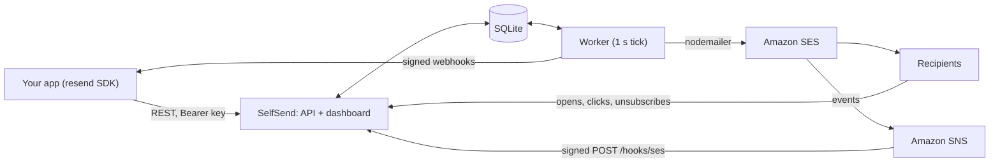

# SelfSend

A self-hosted email API and dashboard on Amazon SES that implements the Resend API, so apps built on the official `resend` SDK can switch by changing one URL.

## The problem

Hosted email APIs are easy to build on, but you pay a monthly plan that grows with your volume. Amazon SES costs about $0.10 per 1,000 emails, but it only sends: there is no dashboard, no contact lists, no unsubscribe pages and no webhooks in a shape your app can use. SelfSend adds that layer on top of SES and speaks Resend's wire format, so existing code keeps working and you pay SES prices plus a small server.

## Features

**Sending**

- `POST /emails` with `to`, `cc`, `bcc`, `reply_to`, HTML and text bodies, custom headers, tags and attachments (base64 content or an http(s) URL, 40 MB total).
- Batch sends of up to 100 emails, with Resend's strict and permissive validation modes.
- Scheduling with ISO 8601 or phrases like `in 2 hours`, up to 30 days ahead. Scheduled emails can be moved or canceled.
- `Idempotency-Key` support. A repeated key replays the first response for 24 hours. The same key with a different body returns `409`.
- A background worker with a per-second rate limit. Throttling and network errors are retried with backoff (30 s, 2 min, 10 min, 30 min, then hourly) up to `MAX_SEND_ATTEMPTS`. Rejected messages and SMTP 5xx errors fail at once.
- Three transports: Amazon SES, any SMTP server, or `log` for development, which writes each message to `data/outbox/<id>.eml` and sends nothing.

**Domains and deliverability**

- Adding a domain creates the SES identity with Easy DKIM and a custom MAIL FROM subdomain (`send.` by default). The dashboard lists the exact DNS records to create and checks for a DMARC record.
- Sends from unverified domains are rejected.
- Permanent bounces and spam complaints add the address to the suppression list. Complaints also unsubscribe the contact. Suppressed recipients are removed at send time.
- The overview page warns when the 30-day bounce rate passes 3% or the complaint rate passes 0.08%, before the 5% and 0.1% levels at which AWS reviews accounts.

**Contacts and broadcasts**

- Contacts with first and last name, free-form properties and a subscribed flag, grouped into segments.
- CSV import in the dashboard (up to 50,000 rows; extra columns become contact properties).
- Broadcasts to a segment: drafts, send now or later, test sends and preview text.
- Merge tags: `{{{FIRST_NAME|there}}}`, `{{{LAST_NAME}}}`, `{{{EMAIL}}}`, any contact property, and `{{{RESEND_UNSUBSCRIBE_URL}}}`.
- Every broadcast email gets `List-Unsubscribe` and `List-Unsubscribe-Post` headers (RFC 8058 one-click unsubscribe). If the content has no unsubscribe link, a footer with one and your postal address is added.
- Per-broadcast delivery, open, click, bounce and complaint counts.

**Tracking and events**

- Open tracking (a 1×1 pixel) and click tracking (rewritten links), switched on per domain.
- Tracking and unsubscribe links carry HMAC-signed tokens. The click endpoint only redirects to the URL inside a valid token, so it cannot be used as an open redirect.
- SES delivery, bounce, complaint, delay, reject and rendering-failure events arrive through Amazon SNS. Each SNS message's signature is checked against the AWS signing certificate before it is used.
- Outgoing webhooks for 17 event types (`email.*`, `contact.*`, `domain.*`), signed with the Standard Webhooks scheme. Failed deliveries are retried after 5 s, 5 min, 30 min, 2 h, 5 h and 10 h.

**Access and admin**

- API keys are stored as SHA-256 hashes. A key has full access or sending-only access, and can be restricted to one domain.
- A password-protected dashboard: overview (30-day stats, 14-day volume chart, monthly cost estimate), email log with search and an event timeline, broadcasts, contacts, domains, API keys, webhooks with a delivery log, suppressions and settings. Email previews render in a sandboxed iframe.
- A CLI to create API keys, connect SES events to SNS, and take a consistent SQLite backup while the server runs.

## How it works



- One Node.js process runs the HTTP server and the background worker. All state lives in one SQLite file (built-in `node:sqlite`, WAL mode). There is no Redis, message queue or separate database.
- An API call validates the request, checks that the sender's domain is verified, stores the email as `queued` or `scheduled` and returns its id right away.
- The worker runs every second, and right away when a new email arrives. Each tick it expands due broadcasts into one email per subscribed contact, sends due emails within the rate limit, and delivers pending webhooks. Every 10 minutes it deletes expired idempotency keys and old webhook logs.
- Before sending, the worker drops suppressed recipients, adds tracking if the domain has it switched on, and tags the SES message with the internal email id so later SES events can be matched to it.
- Events can arrive out of order (an open before SES reports delivery). Each email's status only moves to a stronger state, so a late `delivered` never overwrites `clicked`.
- On restart, emails left in `sending` go back on the queue.

### SES setup

`npm run cli -- setup-ses` does the one-time AWS wiring:

1. Creates an SES configuration set (`selfsend` unless `SES_CONFIGURATION_SET` is set).
2. Creates an SNS topic `<set>-events` and a topic policy that lets only SES in your account publish to it.
3. Adds an event destination for send, delivery, bounce, complaint, reject, delivery-delay and rendering-failure events.
4. Subscribes `PUBLIC_URL/hooks/ses` over HTTPS. The running server confirms the subscription by itself.

Adding a domain calls `CreateEmailIdentity` and `PutEmailIdentityMailFromAttributes`. The Verify button reads DKIM and MAIL FROM status back from SES. Removing a domain deletes the SES identity. With the `smtp` and `log` transports there is no SES identity: the SMTP provider handles authentication, and Verify marks the domain verified.

### How Resend compatibility works

- Endpoints use the same paths as Resend's API (`/emails`, `/domains`, and so on). The SDK only needs a different base URL: set `RESEND_BASE_URL` or pass `{ baseUrl }` to the `Resend` constructor.
- Requests use `Authorization: Bearer <key>`. Keys use Resend's `re_` prefix.
- Errors return `{ statusCode, message, name }`, using the error names the SDK knows (`validation_error`, `invalid_api_key`, `restricted_api_key`, and others).
- Lists use cursor pagination (`limit`, `after`, `before`). Ids are UUIDv7, so sorting by id sorts by creation time.
- Webhooks send `webhook-id`, `webhook-timestamp` and `webhook-signature` headers (plus `svix-*` copies), so `resend.webhooks.verify()` and Svix libraries accept them.
- Legacy `audience_id` fields and `/audiences/:id/contacts` paths map to segments.

The wire format was worked out by static analysis of the published `resend@6.34.1` package. `test/sdk.test.ts` checks it by starting a real server and calling it with the official SDK.

## Tech stack

- Node.js 22.18+ running TypeScript directly through type stripping (no build step)
- Hono and `@hono/node-server` for the API and the server-rendered dashboard (no frontend framework)
- `node:sqlite` for storage
- zod for request validation
- nodemailer for MIME building and the SES and SMTP transports
- AWS SDK v3 (`@aws-sdk/client-sesv2`, `@aws-sdk/client-sns`)
- `node:test` with the official `resend` SDK for end-to-end tests
- Docker and Caddy (automatic HTTPS) for deployment

## Getting started

### Prerequisites

- Node.js 22.18 or newer.
- For real sending: an AWS account with SES, a domain whose DNS you control, and a public HTTPS hostname for the server. SNS and the tracking links need to reach it.
- For production: a small server with Docker and Docker Compose. One vCPU and 1–2 GB of RAM is enough.

### Run locally (no AWS needed)

```bash
npm install
ADMIN_PASSWORD=dev npm run dev          # MAIL_TRANSPORT defaults to "log": nothing leaves your machine
npm run cli -- create-key local         # prints an re_... API key
# then open http://localhost:3000/dashboard and log in with the password above
```

In the dashboard, add a domain (for example `example.com`) under Domains and click Verify DNS. In `log` mode this marks it verified, so you can send from it. Then call the server with the SDK:

```ts
import { Resend } from 'resend';

const resend = new Resend('re_...', { baseUrl: 'http://localhost:3000' });
await resend.emails.send({
  from: 'Example <hello@example.com>',
  to: 'user@example.com',
  subject: 'Hello',
  html: '<p>It works.</p>',
});
```

Each message is written to `data/outbox/<email-id>.eml`, and delivery is simulated so the dashboard has data.

Other commands:

```bash
npm test             # end-to-end suite using the official resend SDK (log transport, temporary database)
npm run typecheck    # tsc --noEmit
```

### Environment variables

The server reads plain environment variables and does not load `.env` by itself. Docker Compose loads `.env` for you. For local runs, export the variables or use `node --env-file=.env src/server.ts`. Every variable is listed with a comment in [`.env.example`](.env.example).

| Variable | Default | Purpose |
|---|---|---|
| `PUBLIC_URL` | `http://localhost:PORT` | Public HTTPS URL; used in links and as the SNS endpoint |
| `DOMAIN` | none | Hostname for Caddy's TLS certificate (Docker Compose only) |
| `ADMIN_PASSWORD` | empty | Dashboard password; the dashboard is off while empty |
| `MAIL_TRANSPORT` | `log` | `ses`, `smtp` or `log` |
| `PORT` | `3000` | HTTP port |
| `DATABASE_PATH` | `./data/selfsend.db` | SQLite file |
| `APP_SECRET` | generated | Signing key for links and sessions; stored in the database if unset |
| `AWS_REGION` | `us-east-1` | SES region |
| `AWS_ACCESS_KEY_ID`, `AWS_SECRET_ACCESS_KEY` | none | IAM credentials (any AWS SDK credential source works) |
| `SES_CONFIGURATION_SET` | empty | Configuration set that publishes events; printed by `setup-ses` |
| `SES_SNS_TOPIC_ARN` | empty | Only accept SNS messages from this topic; printed by `setup-ses` |
| `SMTP_URL` | empty | Required when `MAIL_TRANSPORT=smtp` |
| `SEND_RATE_PER_SECOND` | `10` | Send rate limit |
| `MAX_SEND_ATTEMPTS` | `5` | Attempts before a send is marked failed |
| `REQUIRE_VERIFIED_DOMAIN` | `true` | Set to `false` to allow unverified sender domains |
| `COMPANY_ADDRESS` | empty | Postal address for broadcast footers |
| `SES_PRICE_PER_1000`, `FIXED_MONTHLY_COST` | `0.10`, `6` | Used only for the dashboard's cost estimate |

### Database

There is nothing to set up. On start the server creates the SQLite file at `DATABASE_PATH` and its tables. The schema uses `CREATE TABLE IF NOT EXISTS`; there is no migration tool.

To back up while the server runs:

```bash
npm run cli -- backup                   # writes ./data/backup-YYYY-MM-DD.db
npm run cli -- backup /path/to/file.db  # the target file must not exist yet
```

### Deploy with Amazon SES

1. **SES account.** In the SES console for your region, request production access. Sandbox accounts can only send to verified addresses; approval usually takes about a day.
2. **IAM user.** Create a user with the policy below and put its access keys in `.env`.
3. **Server.** Point an `A` record for your hostname (for example `mail.example.com`) at the server. Then:
   ```bash
   cp .env.example .env    # set PUBLIC_URL, DOMAIN, ADMIN_PASSWORD, AWS_REGION and the AWS keys
   docker compose up -d --build
   ```
   Caddy gets the TLS certificate automatically.
4. **Events.** Run `docker compose exec app node src/cli.ts setup-ses`. Copy the two printed variables (`SES_CONFIGURATION_SET`, `SES_SNS_TOPIC_ARN`) into `.env`, then run `docker compose up -d` to restart with them.
5. **Domain.** In Dashboard → Domains, add your sending domain (for example `example.com`). Create the DNS records it shows: three DKIM `CNAME` records, an `MX` and a `TXT` record on the `send` subdomain, and a DMARC `TXT` record on `_dmarc`. Then click Verify DNS.
6. **Your app.** Create an API key under API Keys. In your app, set `RESEND_API_KEY` to that key and `RESEND_BASE_URL=https://mail.example.com`.
7. **Backups.** Add a cron job that runs `docker compose exec -T app node src/cli.ts backup` and copies the new file in `data/` off the server.

IAM policy for the app user (the SNS actions are only needed by `setup-ses`):

```json
{
  "Version": "2012-10-17",
  "Statement": [
    {
      "Effect": "Allow",
      "Action": [
        "ses:SendEmail", "ses:SendRawEmail",
        "ses:CreateEmailIdentity", "ses:GetEmailIdentity", "ses:DeleteEmailIdentity",
        "ses:PutEmailIdentityMailFromAttributes",
        "ses:CreateConfigurationSet", "ses:CreateConfigurationSetEventDestination"
      ],
      "Resource": "*"
    },
    {
      "Effect": "Allow",
      "Action": ["sns:CreateTopic", "sns:SetTopicAttributes", "sns:Subscribe"],
      "Resource": "*"
    }
  ]
}
```

## API compatibility notes

Supported endpoints:

| Area | Endpoints |
|---|---|
| Emails | `POST /emails`, `POST /emails/batch`, `GET /emails`, `GET /emails/:id`, `PATCH /emails/:id` (reschedule), `POST /emails/:id/cancel` |
| Domains | `POST /domains`, `GET /domains`, `GET /domains/:id`, `PATCH /domains/:id` (tracking), `POST /domains/:id/verify`, `DELETE /domains/:id` |
| API keys | `POST /api-keys`, `GET /api-keys`, `DELETE /api-keys/:id` |
| Contacts | `POST /contacts`, `GET /contacts`, `GET`/`PATCH`/`DELETE /contacts/:id_or_email`, `GET /contacts/:id_or_email/segments`, `POST`/`DELETE /contacts/:id_or_email/segments/:segment_id` |
| Segments | `POST /segments`, `GET /segments`, `GET`/`PATCH`/`DELETE /segments/:id`, `GET /segments/:id/contacts` |
| Audiences (legacy) | `POST`/`GET /audiences/:id/contacts`, `GET`/`PATCH`/`DELETE /audiences/:id/contacts/:id_or_email` |
| Broadcasts | `POST /broadcasts`, `GET /broadcasts`, `GET`/`PATCH`/`DELETE /broadcasts/:id`, `POST /broadcasts/:id/send` |
| Webhooks | `POST /webhooks`, `GET /webhooks`, `GET`/`PATCH`/`DELETE /webhooks/:id` |
| Suppressions | `POST /suppressions`, `POST /suppressions/batch/add`, `GET /suppressions`, `GET`/`DELETE /suppressions/:email` |

Differences from Resend:

- Hosted templates are not supported. A request with `template` gets a validation error. Render the HTML in your app and send `html`. The SDK's `react` option still works, because the SDK renders React Email to HTML before sending.
- `topic_id` and contact `topics` are accepted and ignored.
- Batch sends do not accept attachments. `to` takes at most 50 addresses.
- The `region` field on `POST /domains` is ignored; domains use `AWS_REGION`.
- `GET /suppressions` returns the newest 100 entries without cursor pagination.
- Creating or listing audiences is not supported. Use segments.
- Anything not listed above, such as inbound email or contact property definitions, returns `404`.
- There is no per-key rate limiting.

## Project structure

```
src/
  server.ts       entry point: starts the HTTP server and worker, handles shutdown
  app.ts          route wiring and error handling
  config.ts       environment variables
  db.ts           SQLite schema, query helpers, app signing secret
  worker.ts       send queue, broadcast fan-out, webhook delivery, cleanup
  events.ts       email events, status ordering, suppressions, webhook dispatch
  public.ts       /health, open pixel, click redirect, unsubscribe pages, /hooks/ses
  cli.ts          create-key, setup-ses, backup
  models.ts       row types and Resend-shaped serializers
  errors.ts       Resend-style API errors
  util.ts         ids, hashing, signed tokens, address and date parsing
  api/            Resend-compatible REST API, one file per resource, plus auth and idempotency
  mail/           transports, SES domain identities, SNS event handling, merge tags and tracking, queue
  dashboard/      server-rendered admin UI
test/
  sdk.test.ts     end-to-end tests that drive a real server with the official resend SDK
Dockerfile, docker-compose.yml, Caddyfile   production setup behind Caddy
```

## Status and limitations

SelfSend is at version 0.1.0. It is a working single-tenant service, not a hardened multi-tenant platform.

- It runs as one process with one SQLite file. Run a single instance per database: two instances on the same file could send the same email twice. It scales up, not out.
- The dashboard has one shared admin password. There are no user accounts, roles or audit log.
- Contacts and the suppression list are global to the install, not per domain.
- The automated tests use the `log` transport. The SES transport, domain provisioning and SNS event handling are not covered by automated tests.
- Open counts are inflated by mail privacy features that pre-load images, such as Apple Mail Privacy Protection. Click counts are more reliable.
- There are no schema migrations.
- The dashboard's cost card is an estimate based on the prices you configure.
